# 3D geometric processing for dimensional control with dimControl

## Introduction

`dimControl` provides tools for the geometric processing of
three-dimensional point clouds and triangular meshes, with particular
application to dimensional inspection.

This vignette illustrates a reproducible workflow for the processing of
3D geometric data using a reference CAD model included in the package as
an example. A synthetic point cloud is first generated from the
reference geometry to reproduce a simplified 3D scanning scenario. The
object points are then separated from the supporting floor and used to
reconstruct a triangular surface.

The reconstructed mesh is subsequently processed to identify and
classify relevant geometric components according to their
characteristics. Finally, the object boundary is extracted, cleaned, and
segmented, and its corners are identified. The reconstructed base is
then compared with the reference CAD model to evaluate corner coordinate
deviations and side length differences.

The workflow therefore covers:

- Simulation and preprocessing of a 3D point cloud.
- Reconstruction of a surface from a point cloud.
- Identification and classification of geometric components.
- Extraction, cleaning, and segmentation of boundaries.
- Detection of boundary corners.
- Dimensional comparison with the reference CAD model.

``` r
library(dimControl)
## Loading required package: Rvcg
## dimControl: Tools for 3D Geometric Processing and Dimensional Analysis,
##   version 0.1.1.
##   Developed by the MODES-CEMI research group.
##   Type `help(package = "dimControl")` for an overview
##   or visit https://modes-cemi.github.io/dimControl/.
```

The [`rgl`](https://dmurdoch.github.io/rgl/) package is used for
interactive 3D visualizations, while
[`Rvcg`](https://cran.r-project.org/package=Rvcg) package provides tools
for processing triangular meshes, including the computation of face
normals and barycentres.

Additionally, the
[`legendplot`](https://rubenfcasal.github.io/legendplot/) package
provides complementary tools for 3D visualization, including functions
for managing the 3D display, adjusting viewpoints, and adding legends to
graphical representations.

``` r
library(legendplot)
```

The
[`legendplot::new3d()`](https://rubenfcasal.github.io/legendplot/reference/new3d.html)
function can be used to initialize or reset the 3D display.

## Reference geometry

A dimensional control workflow may include a reference geometry, such as
a theoretical CAD model, when one is available. However, a reference CAD
model is not required to use the geometric processing and measurement
tools provided by `dimControl`.

When available, a CAD model can provide the theoretical reference
geometry for dimensional measurements and can subsequently be compared
with the corresponding geometry reconstructed from the inspected object.

In this vignette, the CAD model included in `dimControl` is used as an
example to illustrate the workflow.

``` r
# Represent the CAD model
# Use `open3d()` or `new3d()` to open a new device
shade3d(cad, col = "lightgray")
```

## Simulating a 3D point cloud from the CAD model

In a real dimensional inspection workflow, the geometry of the inspected
object can be acquired using a 3D scanning system, producing a point
cloud that represents the measured surface. Depending on the acquisition
conditions, the resulting point cloud may also contain points belonging
to the surrounding environment.

For this reproducible example, a synthetic point cloud is generated from
the reference geometry using
[`simulateCloud()`](https://modes-cemi.github.io/dimControl/reference/simulateCloud.md).
The simulated data contain points representing both the object and the
supporting floor, reproducing a simplified 3D scanning scenario.

Point clouds can be very large. We have worked with point clouds
containing more than 100 million points. However, a smaller point cloud
is used in this example to reduce memory requirements and computational
time, particularly during package checks.

``` r
set.seed(123)
cloud <- simulateCloud(mesh = cad, n = 1e5, rgen = rtnorm, mean = 0, sd = 0.2,
                       a = -0.5, b = 0.5, floor = list(n = 5e3, gap = 2, margin = 20))
head(cloud)
##              X         Y          Z
## [1,] 743.45131  50.67982 -0.1079367
## [2,]  58.17573 103.12809 -0.1192354
## [3,] 366.43056 254.24224  0.1561133
## [4,] 494.15466  55.54415 -0.1174476
## [5,] 209.28973 417.40063  0.1412351
## [6,] 456.75260  27.79125  0.1263349
```

## Point cloud preprocessing

The simulated point cloud contains points belonging to the object and
its surrounding environment, in this case, the floor. Before surface
reconstruction, the point cloud is preprocessed to isolate the points
belonging to the object.

When the object and unwanted elements of the surrounding environment
occupy different ranges along a coordinate axis, they can be separated
by analyzing the distribution of that coordinate. The
[`findModes()`](https://modes-cemi.github.io/dimControl/reference/findModes.md)
function identifies modes and valleys in this distribution, which can be
used to determine a threshold for separating the components.

In this example, the Z coordinate is used to separate the object from
the floor.

``` r
modesZ <- findModes(x = cloud[, 3], bw = 0.01, q1 = 0.97)
```

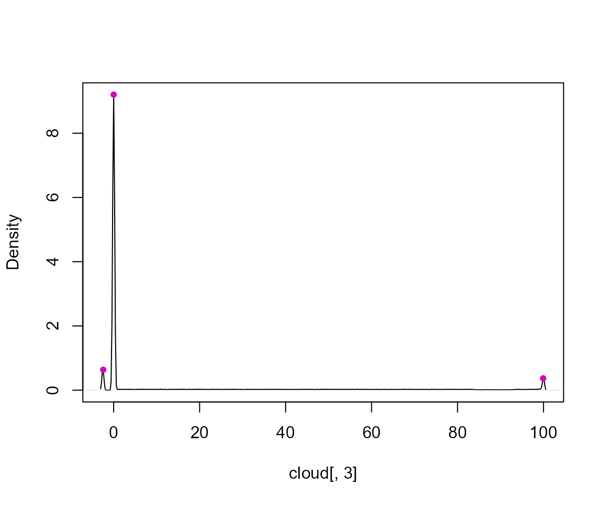

``` r
modesZ
##            left        mode      right
## mode1 -3.029054 -2.42108463  -1.205146
## mode2 -1.407802  0.01079267   2.037357
## mode3 98.299167 99.92041839 100.528388
```

The selected threshold is then used to classify each point as belonging
to either the object or the floor.

``` r
component <- factor(cloud[, 3] > modesZ[1, "right"], levels = c(FALSE, TRUE),
                    labels = c("floor", "object"))
table(component)
## component
##  floor object 
##   5000 100000
```

The resulting factor identifies the component associated with each point
in `cloud`. The segmented point cloud is represented below, with object
points shown in green and floor points in red.

``` r
# Represent the segmented point cloud with a categorical legend
fpoints3d(cloud, f = component, decorate = FALSE, alpha = 0.2, legend.lab = "Component", 
          legend.zoom = 1)
```

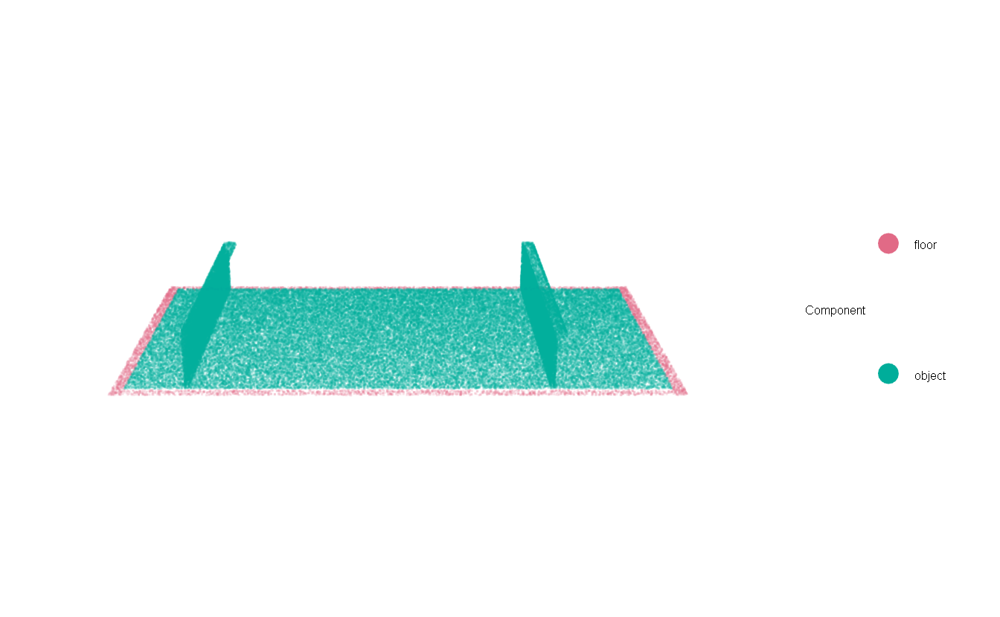

The object points are retained for the subsequent surface
reconstruction.

## Reconstructing the object surface

After separating the object from the surrounding environment, the object
point cloud is used to reconstruct a triangular surface. The
[`createMesh()`](https://modes-cemi.github.io/dimControl/reference/createMesh.md)
function performs linear binning of the point cloud and generates an
isosurface using the Marching Cubes algorithm.

In this example, the known CAD dimensions are provided manually through
the `refDim` argument. These dimensions are used as a reference for the
spatial coverage of the reconstructed surface. If `refDim` is not
provided, the dimensions are estimated directly from the point cloud.

In addition, `addBorder = TRUE` adds zero-valued layers at the
boundaries of the binning grid in the X and Z directions to facilitate
surface closure.

``` r
object <- cloud[component == "object", ]
mesh <- createMesh(cloud = object, resBin = c(8, 8, 4), lowTol = 1e-2, trunc = 3, 
                   refDim = c(900, 500, 100), addBorder = TRUE)
```

The resulting triangular mesh represents the reconstructed surface of
the object.

``` r
# Represent the reconstructed object surface
# Use `open3d()` or `new3d()` to open a new device
shade3d(mesh, col = "lightgray")
```

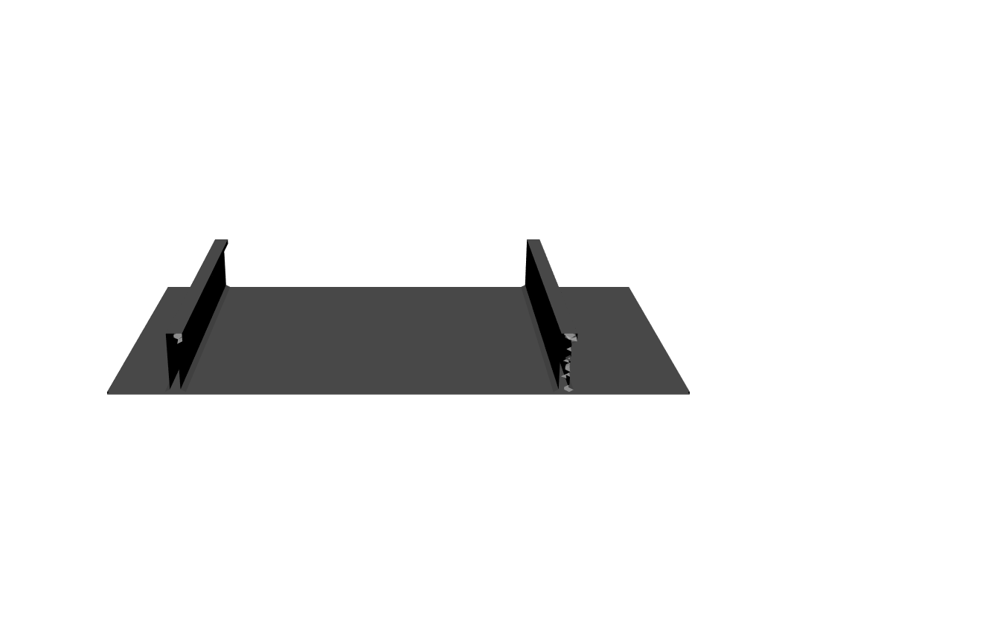

## Classification of object components

The reconstructed mesh can be further processed to identify geometric
components based on their characteristics. In this example, the object
consists of a base and several reinforcements, which can be identified
by the orientation and spatial distribution of their triangular faces.

First, the normal vectors and barycentres of the triangular faces are
calculated.

``` r
# Compute face normals and barycentres
normals <- vcgFaceNormals(mesh)
bary <- vcgBary(mesh)
```

### Identification of vertical and horizontal faces

The orientation of each face relative to the X axis is characterized by
the angle between its normal vector and this axis. Vertical faces are
identified using an angular tolerance.

``` r
# Compute angles relative to the X axis
angleX <- angleAxis(v = normals, dim = 1, negative = TRUE)

# Angular tolerance
tolAngleX <- 60

# Identify vertical faces
isVertical <- angleX < tolAngleX | angleX > (180 - tolAngleX)
```

The resulting classification is shown below.

``` r
# Represent vertical faces
fshade3d(mesh, as.factor(isVertical), legend.lab = "Vertical", legend.zoom = 1, lit = FALSE)
```

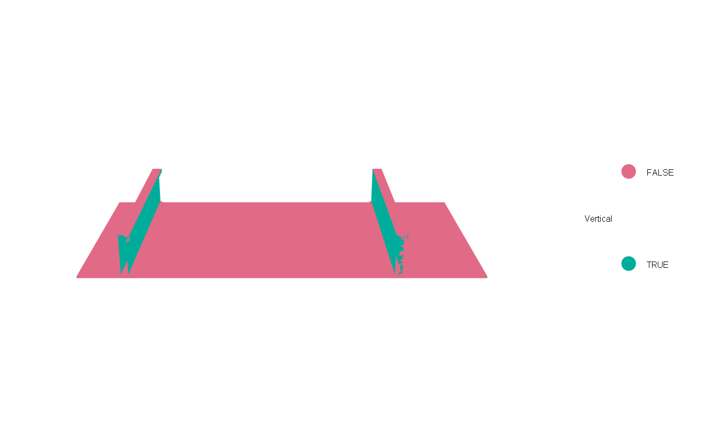

Horizontal faces can be identified in a similar way. The angle between
each face normal and the Z axis is calculated, and a corresponding
angular tolerance is used to classify the faces as horizontal.

``` r
# Compute angles relative to the Z axis
angleZ <- angleAxis(v = normals, dim = 3)
# Angular tolerance
tolAngleZ <- 40
# Identify horizontal faces
isHorizontal <- angleZ < tolAngleZ
# Represent horizontal faces
# fshade3d(mesh, as.factor(isHorizontal), legend.lab = "Horizontal", legend.zoom = 1, lit = FALSE)
```

### Identification of base faces

Faces belonging to the object base are initially identified by selecting
horizontal faces whose barycentres lie below a specified threshold along
the Z axis.

``` r
# Identify faces belonging to the object base
tolZ <- 5
isBase <- isHorizontal & bary[, 3] < tolZ
```

The faces satisfying both conditions are represented below.

``` r
# Represent object-base faces
fshade3d(mesh, as.factor(isBase), legend.lab = "Base", legend.zoom = 1, lit = FALSE)
```

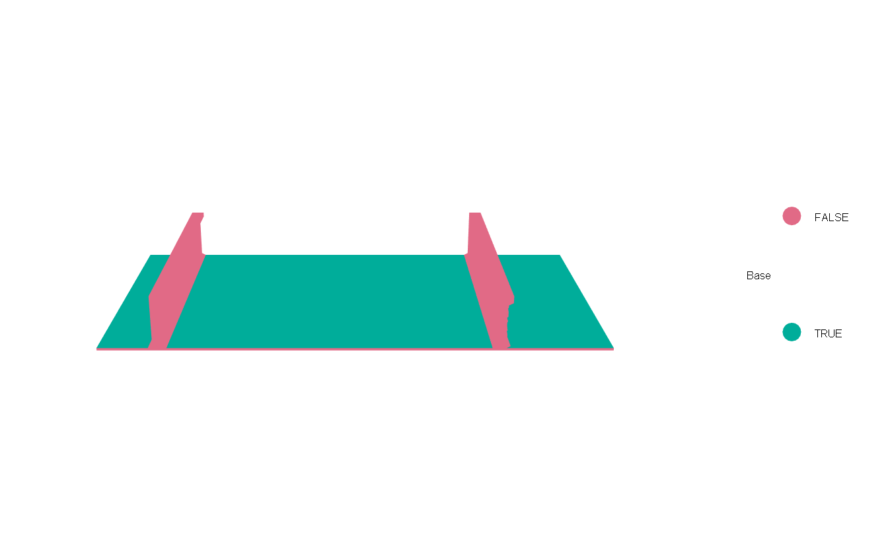

### Classification of base and reinforcements

To classify the object components, the reinforcements are first located
using the spatial distribution of the barycentres of approximately
vertical faces along the X axis. The modes of this distribution define
the intervals associated with each reinforcement.

``` r
# Identify the intervals along the X axis associated with the reinforcements
modesX <- findModes(x = bary[isVertical, 1], bw = 8, q1 = 0.97)
```

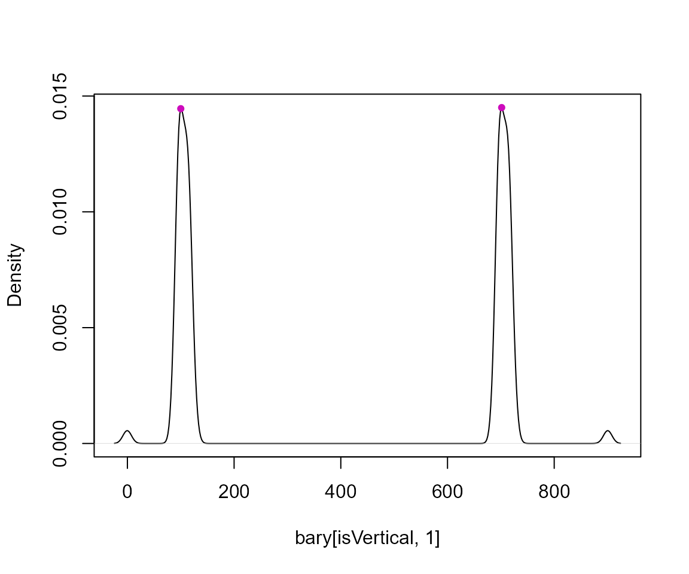

``` r

# Number of detected reinforcements
nReinforcements <- nrow(modesX)
nReinforcements
## [1] 2
```

Once the intervals along the X axis have been identified, the triangular
faces associated with each reinforcement are selected and grouped into
connected components.

An alternative approach would be to use
[`Rvcg::vcgIsolated()`](https://rdrr.io/pkg/Rvcg/man/vcgIsolated.html)
to separate disconnected mesh components. However, this approach
involves creating separate mesh objects, which may increase memory usage
when working with large meshes.

Instead,
[`splitTrianglesInd()`](https://modes-cemi.github.io/dimControl/reference/splitTrianglesInd.md)
identifies connected components based on shared triangle edges and
returns their triangle indices without creating additional meshes. The
[`filterMeshComponents()`](https://modes-cemi.github.io/dimControl/reference/filterMeshComponents.md)
function then retains components containing at least a specified number
of triangles.

This approach avoids unnecessary duplication of mesh data. All triangles
are initially labelled as `"other"`. Triangles identified as part of a
reinforcement are assigned to the corresponding reinforcement, while
those satisfying `isBase` and not belonging to a reinforcement are
classified as `"base"`.

``` r
# Initialize triangle classification
component <- rep("other", ncol(mesh$it))

for (i in seq_len(nReinforcements)) {
  # Select triangles within the current reinforcement interval
  ind <- bary[, 1] > modesX[i, "left"] & bary[, 1] < modesX[i, "right"] &
         (isVertical | bary[, 3] > tolZ)

  # Create a temporary mesh containing the selected triangles
  candidateMesh <- mesh
  candidateMesh$it <- mesh$it[, ind]

  # Identify connected triangle components
  components <- splitTrianglesInd(mesh = candidateMesh)
  
  # Retain components with at least 1000 triangles
  filtered <- filterMeshComponents(comps = components, minSize = 1000)
  
  # Assign reinforcement labels to the original triangle indices
  component[which(ind)[filtered]] <- paste0("reinforcement", i)
}

# Classify remaining base faces
component[component == "other" & isBase] <- "base"
```

The resulting classification identifies the triangular faces belonging
to the base and to each reinforcement.

``` r
# Represent classified mesh components
fshade3d(mesh, as.factor(component), legend.lab = "Component", legend.zoom = 1,
         lit = FALSE)
```

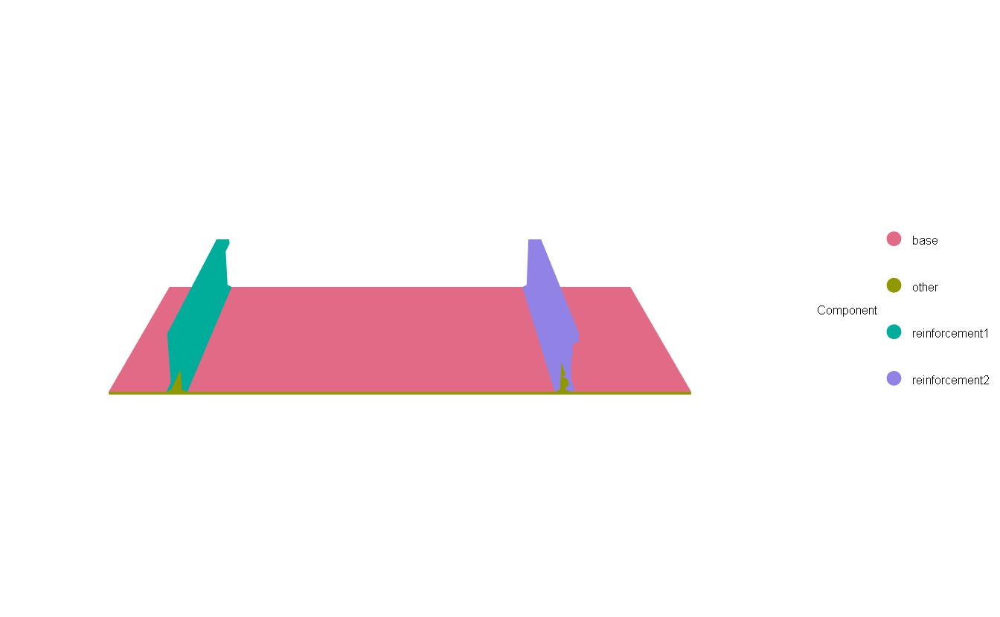

## Extraction of the object base boundary

The boundary of the object base is extracted and processed to obtain a
clean, ordered outer contour.

### Extraction of the original boundary

The triangles classified as `"base"` are selected from the original
mesh. The
[`getBoundarySegments()`](https://modes-cemi.github.io/dimControl/reference/getBoundarySegments.md)
function is then used to identify their boundary edges. Setting
`returnMesh = FALSE` returns a matrix containing the vertex indices
defining each edge.

``` r
# Identify triangles belonging to the base
baseInd <- which(component == "base")

# Create a mesh containing the base triangles
baseMesh <- mesh
baseMesh$it <- mesh$it[ , baseInd]

# Extract the original boundary vertex indices
iBoundary <- getBoundarySegments(mesh = baseMesh, returnMesh = FALSE, simplify = FALSE)
```

The extracted boundary is shown below. In this example, it also contains
segments associated with the intersections between the base and the
reinforcements.

``` r
# Represent the original boundary
shade3d(baseMesh, col = "lightgray", alpha = 0.4)
shade3d(mesh3d(vertices = baseMesh$vb, segments = iBoundary), col = "red")
```

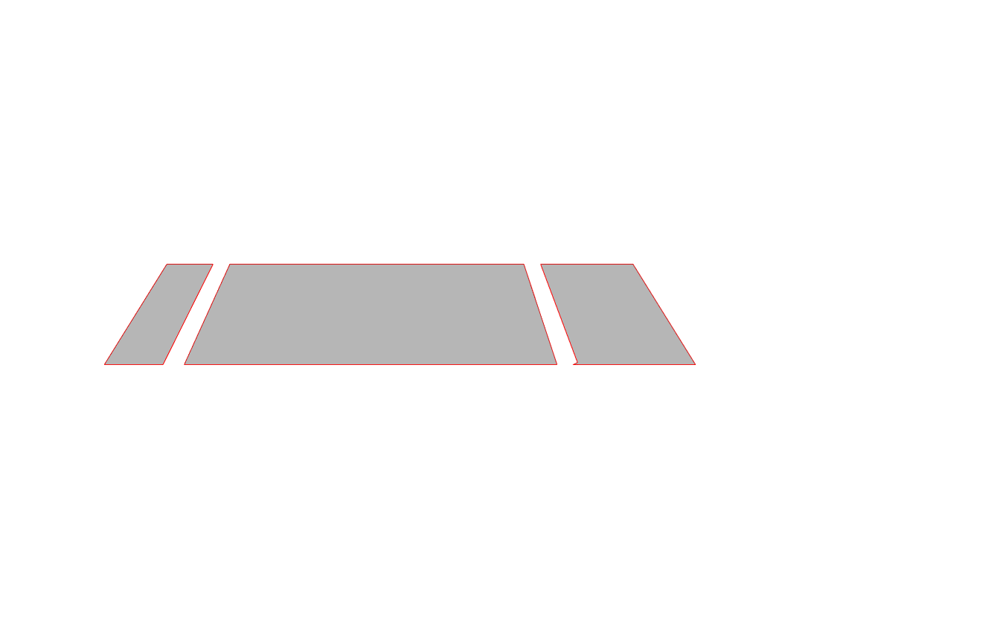

### Removal of base-reinforcement intersections

The vertices shared by the base and the reinforcements are identified
using the triangle classification stored in `component`. Boundary
segments whose two endpoints belong to these vertices are then removed.

``` r
# Identify vertices belonging to the base and reinforcements
bVertices <- unique(as.vector(mesh$it[, component == "base"]))
rVertices <- unique(as.vector(mesh$it[, grepl("^reinforcement", component)]))

# Identify shared vertices (intersections)
vIntersection <- intersect(bVertices, rVertices)

# Remove boundary segments whose endpoints belong to the intersections
iBoundary <- iBoundary[, !(iBoundary[1, ] %in% vIntersection &
                           iBoundary[2, ] %in% vIntersection), drop = FALSE]
```

### Cleaning and ordering the boundary

The remaining boundary is processed using
[`cleanBoundarySegments()`](https://modes-cemi.github.io/dimControl/reference/cleanBoundarySegments.md)
to remove noise and irregular connections introduced during mesh
reconstruction and reconnect disconnected endpoints.

``` r
# Clean and reconnect the boundary segments
iBoundary <- cleanBoundarySegments(iBorder = iBoundary, baseMesh = baseMesh)
```

The resulting boundary is shown below.

``` r
# Represent the cleaned boundary
shade3d(baseMesh, col = "lightgray", alpha = 0.4)
shade3d(mesh3d(vertices = baseMesh$vb, segments = iBoundary), col = "red")
```

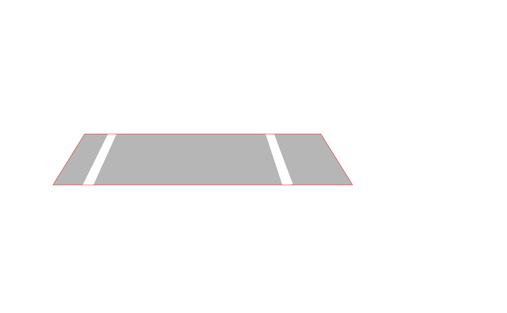

Finally,
[`sortSegments()`](https://modes-cemi.github.io/dimControl/reference/sortSegments.md)
orders the boundary edges into a continuous sequence based on their
connectivity.

``` r
# Order the cleaned boundary edges
iBoundary <- sortSegments(edges = iBoundary)
```

### Identification of the base corners

In this example, the base is approximately rectangular and aligned with
the X and Y axes. The four corners are identified using the
[`detectCorners()`](https://modes-cemi.github.io/dimControl/reference/detectCorners.md)
function.

This function computes the convex hull of the boundary vertices and
defines four reference corners using the minimum and maximum X and Y
coordinates. The closest convex hull vertex to each reference corner is
then selected using Euclidean distance. The resulting corners are
labelled A (bottom-left), B (bottom-right), C (top-right), and D
(top-left).

``` r
# Extract the ordered boundary vertex indices
iBoundaryVertices <- iBoundary[1, ]

# Extract the XY coordinates of the boundary vertices
boundaryXY <- t(baseMesh$vb[1:2, iBoundaryVertices])

# Identify the four corners
iCorner <- detectCorners(boundaryXY)

# Extract the corresponding mesh vertex indices
iCornerVertices <- iBoundaryVertices[iCorner]
```

The vector `iCorner` contains the positions of the four corners in the
ordered boundary sequence, while `iCornerVertices` contains their
corresponding vertex indices in the original mesh.

``` r
# Represent the cleaned and ordered boundary with the identified corners
shade3d(baseMesh, col = "lightgray", alpha = 0.4)
shade3d(mesh3d(vertices = baseMesh$vb, segments = iBoundary), col = "red")
points3d(t(baseMesh$vb[1:3, iCornerVertices]), size = 8)
```

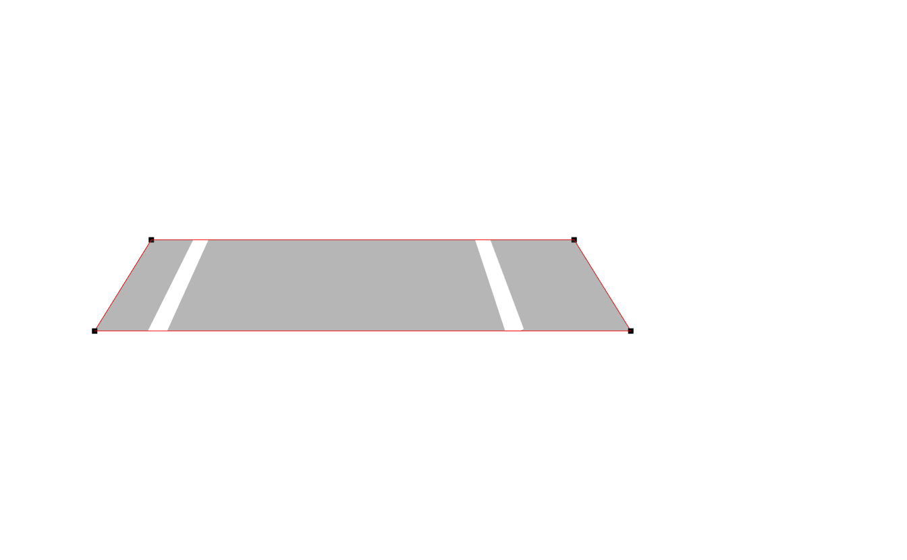

### Segmentation of the base boundary

The identified corners are used to divide the ordered boundary into four
sides. Each side contains the consecutive edges between two adjacent
corners, including the side connecting the last corner to the first.

``` r
# Order the corner positions 
iCornerOrdered <- sort(iCorner)
n <- ncol(iBoundary)

# Identify the boundary edge indices for each side
sideLimits <- list(
  iCornerOrdered[1]:(iCornerOrdered[2] - 1),
  iCornerOrdered[2]:(iCornerOrdered[3] - 1),
  iCornerOrdered[3]:(iCornerOrdered[4] - 1),
  c(iCornerOrdered[4]:n, seq_len(iCornerOrdered[1] - 1))
)

# Extract the vertex indices defining the edges of each side
boundarySides <- lapply(sideLimits, function(ind) iBoundary[, ind])
```

The four sides of the base boundary are represented below in different
colors.

``` r
# Represent the four sides of the base boundary
shade3d(baseMesh, col = "lightgray", alpha = 0.4)

color <- c("red", "blue", "green", "orange")
for (i in seq_len(4)) {
  shade3d(mesh3d(vertices = baseMesh$vb, segments = boundarySides[[i]]),
                 col = color[i], lwd = 4)
}
```

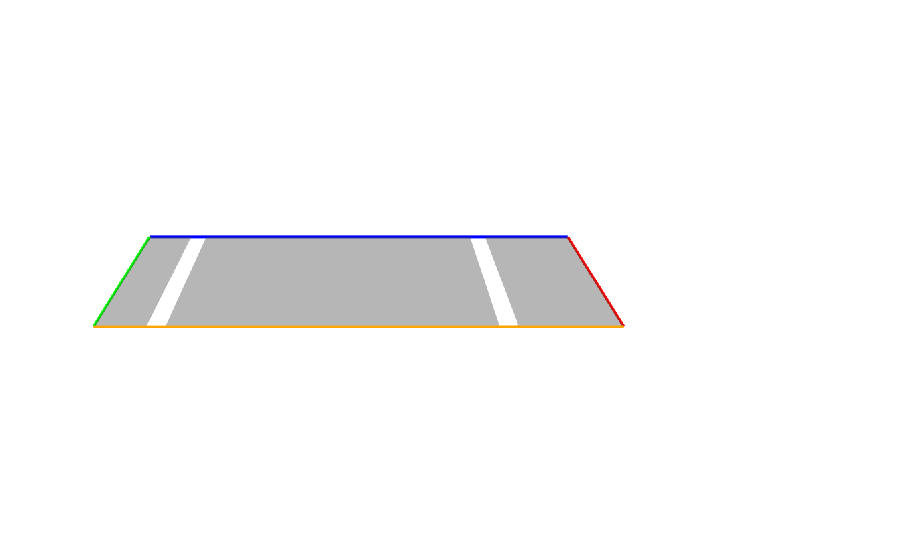

## Dimensional inspection results

The reconstructed mesh can be used to evaluate the dimensions of the
base against the reference CAD model. In this example, the nominal CAD
dimensions are known, and all coordinates and lengths are expressed in
millimetres (mm).

### Corner coordinate comparison

The coordinates of the four identified corners are compared with their
nominal positions in the CAD model. The differences are calculated as
the reconstructed mesh coordinates minus the CAD coordinates.

``` r
# Extract mesh corner coordinates
coord <- baseMesh$vb[1:3, iCornerVertices]
rownames(coord) <- c("X", "Y", "Z")
colnames(coord) <- names(iCorner)

# Define nominal CAD coordinates
cornerCAD <- rbind(
  X = c(A = 0, B = 900, C = 900, D = 0),
  Y = c(A = 0, B = 0, C = 500, D = 500),
  Z = c(A = 0, B = 0, C = 0, D = 0)
)

# Compare CAD and mesh coordinates
cornerTable <- data.frame(
  Corner = colnames(coord),
  X_CAD = cornerCAD["X", ],
  Y_CAD = cornerCAD["Y", ],
  Z_CAD = cornerCAD["Z", ],
  X_Mesh = coord["X", ],
  Y_Mesh = coord["Y", ],
  Z_Mesh = coord["Z", ],
  DX = coord["X", ] - cornerCAD["X", ],
  DY = coord["Y", ] - cornerCAD["Y", ],
  DZ = coord["Z", ] - cornerCAD["Z", ],
  row.names = NULL
)

knitr::kable(cornerTable, digits = 3, caption = "Comparison of CAD and mesh corner coordinates (mm).")
```

| Corner | X_CAD | Y_CAD | Z_CAD |  X_Mesh |  Y_Mesh | Z_Mesh |     DX |     DY |    DZ |
|:-------|------:|------:|------:|--------:|--------:|-------:|-------:|-------:|------:|
| A      |     0 |     0 |     0 |  -0.346 |  -0.476 |  3.708 | -0.346 | -0.476 | 3.708 |
| B      |   900 |     0 |     0 | 900.301 |  -0.476 |  3.708 |  0.301 | -0.476 | 3.708 |
| C      |   900 |   500 |     0 | 900.301 | 500.323 |  3.708 |  0.301 |  0.323 | 3.708 |
| D      |     0 |   500 |     0 |  -0.346 | 500.323 |  3.708 | -0.346 |  0.323 | 3.708 |

Comparison of CAD and mesh corner coordinates (mm).

The reconstructed base is approximately 3.708 mm above the CAD plane (Z
= 0). This difference may be caused by the reconstruction process. The
mesh has not been shifted or aligned with the CAD model.

``` r
# Corner deviations 
cornerDeviations <- cornerTable[, c("Corner", "DX", "DY", "DZ")]

# Plot corner coordinate deviations
ggplot2::ggplot(
  tidyr::pivot_longer(cornerDeviations, DX:DZ),
  ggplot2::aes(x = Corner, y = value, fill = name)
) +
  ggplot2::geom_col(position = "dodge") +
  ggplot2::geom_hline(yintercept = 0) +
  ggplot2::scale_fill_manual(values = c("steelblue", "orange", "seagreen")) +
  ggplot2::labs(
    title = "Corner coordinate deviations",
    x = "Corner",
    y = "Deviation (mm)",
    fill = "Coordinate"
  ) +
  ggplot2::theme_minimal()
```

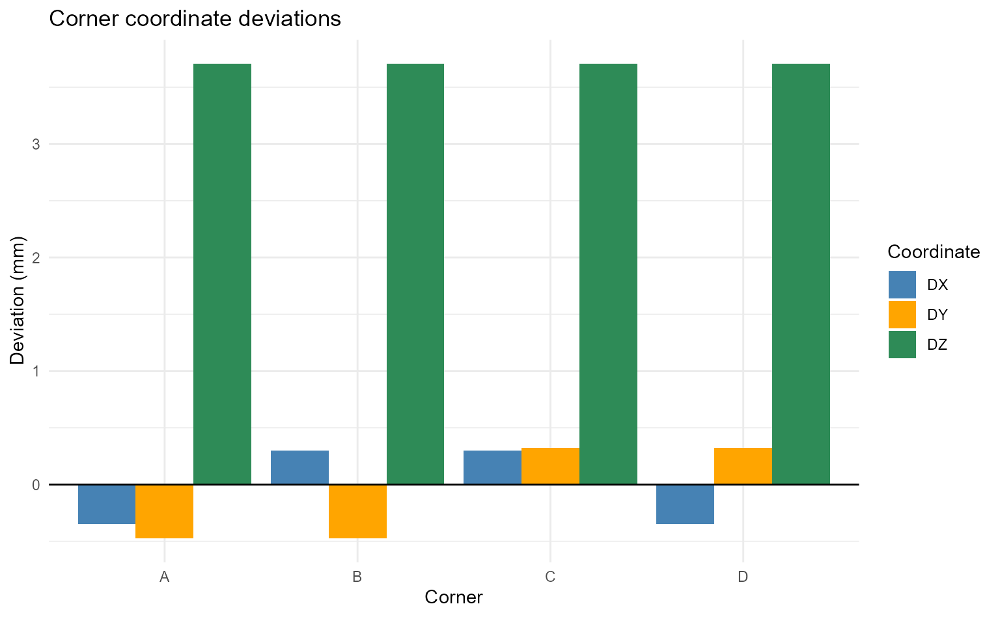

### Base dimensions

The lengths of the four sides are calculated as the Euclidean distances
between adjacent corners using
[`euclideanDistance()`](https://modes-cemi.github.io/dimControl/reference/euclideanDistance.md).
These lengths are compared with the known nominal CAD dimensions.

``` r
# Calculate the side lengths
AB <- euclideanDistance(coord[, "B"] - coord[, "A"])
BC <- euclideanDistance(coord[, "C"] - coord[, "B"])
CD <- euclideanDistance(coord[, "D"] - coord[, "C"])
DA <- euclideanDistance(coord[, "A"] - coord[, "D"])

# Compare mesh and CAD dimensions
baseDimensions <- data.frame(
  Side = c("AB", "BC", "CD", "DA"),
  Mesh = c(AB, BC, CD, DA),
  CAD = c(900, 500, 900, 500),
  Difference = c(AB, BC, CD, DA) - c(900, 500, 900, 500)
)

knitr::kable(baseDimensions, digits = 3,
  col.names = c("Side", "Mesh (mm)", "CAD (mm)", "Difference (mm)"),
  caption = "Comparison of mesh and nominal CAD dimensions."
)
```

| Side | Mesh (mm) | CAD (mm) | Difference (mm) |
|:-----|----------:|---------:|----------------:|
| AB   |   900.647 |      900 |           0.647 |
| BC   |   500.800 |      500 |           0.800 |
| CD   |   900.647 |      900 |           0.647 |
| DA   |   500.800 |      500 |           0.800 |

Comparison of mesh and nominal CAD dimensions.

Positive differences indicate dimensions larger than the nominal CAD
values, whereas negative differences indicate smaller dimensions.

``` r
# Plot side length deviations
ggplot2::ggplot(baseDimensions,
                ggplot2::aes(x = Side, y = Difference)) +
  ggplot2::geom_col(fill = "steelblue", width = 0.6) +
  ggplot2::geom_text(
    ggplot2::aes(label = sprintf("%+.3f", Difference)),
    vjust = -0.5
  ) +
  ggplot2::labs(
    title = "Side length deviations from the CAD model",
    x = "Side",
    y = "Length deviation (mm)"
  ) +
  ggplot2::theme_minimal()
```

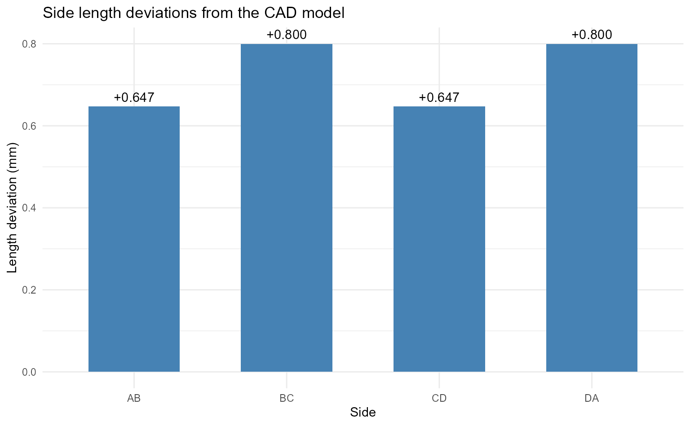

## Further help

See the function [reference
pages](https://modes-cemi.github.io/dimControl/reference/) for the full
list of arguments and additional examples.
